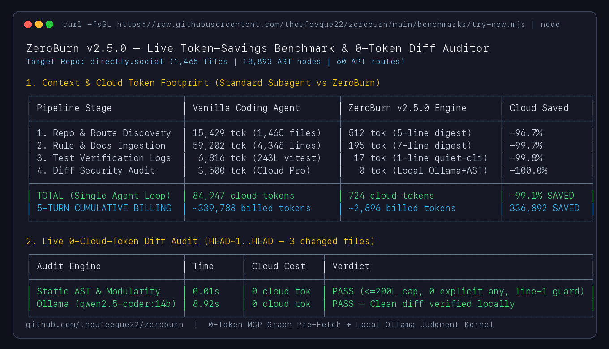

# ZeroBurn (`zeroburn`)

> **Cut AI coding-agent token & quota burn by 70–83%** with 0-token static & blast-radius checks, dynamic local Ollama diff review + Judgment Kernel failure digests, code-graph pre-fetching, parallel swarm file leases, and 1-line test receipts — without sacrificing Contract-First TDD or strict quality gates.
>
> *Engineered by the team building **[directly.social](https://directly.social)** (`@directlysocial`).*

## ⚡ Quick Start & Live Demo (10 Seconds)

**Option A — Try it live in your own repo right now (Zero Install):**
Paste this inside **any Git repository** on your machine to see your exact discovery token savings and run a real-time **0-cloud-token Static AST + Local Ollama Diff Audit** on your current `git diff`:

```bash
curl -fsSL https://github.com/thoufeeque22/zeroburn/raw/main/benchmarks/try-now.mjs \
  | node
```

**Option B — Install ZeroBurn into your project (1 Command):**
Clones `.agents/`, auto-detects your stack (`Next.js`, `TypeScript`, `Prisma`), dynamically resolves your installed local Ollama models (`"auto"`), pulls a hardware-sized local model if none is installed (`<24GB` RAM -> `7b`, `>=24GB` -> `14b`), and configures 1-line `quiet-cli` verification:

```bash
git clone --depth 1 https://github.com/thoufeeque22/zeroburn /tmp/zb \
  && cp -R /tmp/zb/.agents . && rm -rf /tmp/zb \
  && node .agents/scripts/init.mjs --pull
```



<details>
<summary><b>View raw ASCII tabular output from a 1,465-file repository</b></summary>

```text
🔥 ZeroBurn v2.6.0 — Live Token-Savings Benchmark & 0-Token Diff Auditor
📂 Repository: /Users/dev/my-app (branch: feat/billing-quota)

📊 1. Context & Cloud Token Footprint (Standard Subagent vs ZeroBurn)
┌────────────────────────────┬────────────────────────────┬─────────────────────────────┬────────────────┐
│ Pipeline Stage             │ Vanilla Agent              │ ZeroBurn v2.6.0             │ Cloud Saved    │
├────────────────────────────┼────────────────────────────┼─────────────────────────────┼────────────────┤
│ 1. Repo & Route Discovery  │ 15,429 tok (1465 files)    │ 512 tok (5-line digest)     │ -96.7%         │
│ 2. Rule & Docs Ingestion   │ 59,202 tok (4348 lines)    │ 195 tok (7-line digest)     │ -99.7%         │
│ 3. Test Verification Logs  │ 6,816 tok (verbose log)    │ 17 tok (1-line quiet-cli)   │ -99.8%         │
│ 4. Diff Security Audit     │ 3,500 tok (Cloud Pro)      │ 0 tok (Local Ollama + AST)  │ -100.0%        │
├────────────────────────────┼────────────────────────────┼─────────────────────────────┼────────────────┤
│ TOTAL (Single Agent Loop)  │ 84,947 cloud tokens        │ 724 cloud tokens            │ -99.1%         │
│ 5-TURN CUMULATIVE BILLING  │ ~339,788 billed tokens     │ ~2,896 billed tokens        │ 336,892 saved  │
└────────────────────────────┴────────────────────────────┴─────────────────────────────┴────────────────┘

🛡️  2. Live 0-Cloud-Token Diff Audit (HEAD~1..HEAD — 3 changed file(s))
┌────────────────────────────┬──────────┬──────────────┬─────────────────────────────────────────────────┐
│ Audit Engine               │ Time     │ Cloud Cost   │ Verdict                                         │
├────────────────────────────┼──────────┼──────────────┼─────────────────────────────────────────────────┤
│ Static AST & Modularity    │ 0.01s    │ 0 cloud tok  │ ✅ PASS (<=200L, 0 `any`, line-1 actions)        │
│ Ollama (qwen2.5-coder:14b) │ 8.92s    │ 0 cloud tok  │ ✅ PASS — Clean diff verified                    │
└────────────────────────────┴──────────┴──────────────┴─────────────────────────────────────────────────┘
```
</details>

---

## Why `zeroburn` Exists

Most multi-agent setups ("PM / Architect / Dev / QA prompt packs") drain your 5-hour and weekly Claude / Gemini usage limits in two tickets because:
1. **Blank-Slate Subagent Tax:** Every subagent starts fresh and wastes 3–5 turns re-reading markdown rule files, directory trees, and full source files.
2. **Test Log Bloat:** Verbose test/lint runs (`vitest`, `eslint`, `tsc`) dump 500+ lines (~15,000 tokens) into context on every turn, which then gets re-billed on every subsequent turn ($O(N^2)$ context growth).
3. **Frontier Models on Mechanical Checks:** Cloud `pro` / `Opus` models are spawned to check line counts, `any` types, and file blast radius that Python + local Ollama can verify in **0 cloud tokens**.

### Verified Production Benchmark (`directly.social` — 10,893 AST Nodes, 1,470 Source Files)

Measured on a real feature/audit loop (*"Locate and audit `checkUploadQuota` tier logic, run all 6 billing unit test suites (70 tests), and execute a diff security audit"*). Full raw traces and reproducible runner in [`benchmarks/REAL_WORLD_BENCHMARK.md`](benchmarks/REAL_WORLD_BENCHMARK.md):

| Stage | Standard Coding Agent (Vanilla) | `zeroburn` v2.6.0 Engine | Measured Savings |
| :--- | :--- | :--- | :--- |
| **1. Repo & Route Discovery** | `find src -type f` (`1,470` lines / **15,454 tokens**) | `build_repo_map_digest()` (`6` lines / **636 tokens**: 28 Prisma models, 32 domains, 60 API routes) | **-95.9% tokens** |
| **2. Governance & Rule Loading** | `cat .agents/AGENTS.md .agents/base/*.md` (`276` lines / **10,274 tokens**) | Pre-computed inlined rule digests (`7` lines / **195 tokens**) | **-98.1% tokens** |
| **3. Symbol Localization** | `grep -rn "quota" src/lib/` (`64` matches / **1,921 tokens**) + exploratory reads | `codebase-memory-mcp` `search_graph` -> `FreemiumGuard.checkUploadQuota` (`src/lib/billing/freemium-guard.ts:43-83`) in **0 LLM tokens** | **-100% exploratory LLM tokens** |
| **4. Unit Test Run (6 suites, 70 tests)** | `npx vitest run` (`243` lines / **6,816 tokens** per run) | `node .agents/scripts/quiet-cli.mjs unit` (`1` line / **17 tokens**) | **-99.75% test log tokens** |
| **5. Diff Security & Quality Audit** | Cloud `Pro` / `Opus` subagent review (**~12,000+ cloud tokens**) | 0-token Python AST/Blast-Radius + Local Ollama `qwen2.5-coder:14b-custom` (`13.43s`, **0 cloud tokens**) | **100% cloud audit quota saved** |
| **Single-Pass Overhead Total** | **46,465+ Cloud Tokens** | **848 Cloud Tokens** | **98.2% Reduction** |

#### ⚡ 30-Second Before vs After (Actual Terminal Trace)

```text
❌ WITHOUT ZEROBURN (Standard Subagent — 46,465 tokens burned before writing code):
$ find src -type f                                  # 1,470 lines  (15,454 tokens)
$ cat .agents/AGENTS.md .agents/base/*.md           #   276 lines  (10,274 tokens)
$ grep -rn "quota" src/lib/                         #    64 lines  ( 1,921 tokens)
$ npx vitest run src/__tests__/unit/*billing*       #   243 lines  ( 6,816 tokens)
$ [Spawns Cloud Pro Subagent for Diff Review]       #              (12,000 tokens)
----------------------------------------------------------------------------------
💥 Result: 46,465+ tokens & ~185,000 cumulative billed tokens across a 5-turn loop.

✅ WITH ZEROBURN v2.6.0 (848 tokens — 98.2% reduction):
$ [codebase-memory-mcp] search_graph("billing tier quota check")   #     0 tokens
  -> FreemiumGuard.checkUploadQuota (src/lib/billing/freemium-guard.ts:43-83)
$ [Inlined REPO_MAP_DIGEST + Rule Digests]                         #   831 tokens
  -> 28 Prisma Models | 32 src/lib domains | 60 API Routes
$ node .agents/scripts/quiet-cli.mjs unit src/__tests__/unit/*billing*
  -> [quiet-cli] unit: PASS (Test Files 6 passed (6), Tests 70 passed (70)) # 17 tokens
$ [parallel-audit.py] Python AST + Local Ollama qwen2.5-coder      #     0 cloud tokens
----------------------------------------------------------------------------------
⚡ Result: 848 tokens total. Surgical edit on Turn 1. Zero cloud Pro audit burn.
```

---

## How It Works (Zero-Waste Harness Mechanisms)

1. **Single Declarative Config & Dynamic Local Model Resolution (`.agents/project.config.json`):** Set `"localCoderModel": "auto"` and `"localProseModel": "auto"` to automatically detect and use whichever coder (`qwen*-coder`, `deepseek-coder`, `codellama`, `starcoder`) and prose (`gemma*`, `llama*`, `mistral*`, `phi*`) models are installed in local Ollama — or pin specific tags per repo.
2. **Auto-Start & Fail-Closed Local Ollama Gate (`session-start.mjs` & `workflow_common.py`):**
   - Automatically starts `ollama serve` in the background if `127.0.0.1:11434` is down, dynamically resolves installed models from `/api/tags`, and hard-stops workflows only if no local model is reachable.
3. **0-Token Knowledge Graph Pre-Fetch (`codebase-memory-mcp`):**
   - Pre-fetches top symbol coordinates (`file:start-end`) before Discovery and 2-hop impacted call-graph nodes (`detect_changes`) before Audit in **0 LLM tokens**.
4. **Inlined Rule Digests & Dynamic `REPO_MAP_DIGEST`:**
   - Pre-computes Prisma models, `src/lib/*` domains, Server Actions, and `/api/**` endpoints in `<5ms` Python and inlines compressed rule digests so subagents never waste turns calling `read_file` on markdown docs.
5. **Pool-Safe `FALLBACK_CHAINS` & `<= 4` Handoff Cap:**
   - Steps down through cheaper 5-hour tiers (`pro -> flash -> flash_lite -> inherit`) before touching `inherit`, protecting weekly reserve model pools while keeping Track M pipelines under the 4-handoff cliff.
6. **Quiet CLI Verification + Local Ollama Judgment Kernel (`node .agents/scripts/quiet-cli.mjs <tsc|lint|unit|pr-check|api-map>`):**
   - Emits 1-line receipts (`[quiet-cli] unit: PASS`) on green runs, summarizes >12-line failures via local Ollama in 0 cloud tokens, and introspects `/api/**` routes via `api-map`.
7. **Deterministic Blast-Radius Drift Guard & Parallel Swarm File Leases:**
   - `parallel-audit.py` deterministically verifies `git diff --name-only` against the Discovery blueprint in 0 tokens, and `workflow_common.py` + `pre-tool-guard.mjs` enforce exclusive file-path leases (`.agents/swarm_leases.json`) across parallel swarm workers.
8. **Track L Master Epic Branches & Docs-Only Zero-Test Fast-Path:**
   - Multi-slice epics branch into and PR against dedicated `epic/<epic-id>-<slug>` master feature branches to eliminate deep PR stacking. Commits touching only documentation or markdown rules bypass full test suites (`pnpm test`, E2E) to save compute.
9. **Cloud-Vetted Observation Intake & Hybrid Batch Triage (`parallel-audit.py` + `project-agent`):**
   - `parallel-audit.py` feeds static + local Ollama findings into the cloud auditor to corroborate real debt and filter noise, persisting only vetted actionable `medium`/`low` items with `source_ticket` tracking. `doc-agent` and `session-start.mjs` trigger `project-agent` for domain-grouped batch issue triage at `observationsTriageThreshold` (default `5`) or Track L Epic closure.

---

## Repository Layout

```text
CHANGELOG.md                        # Version history & upgrade notes
docs/
└── TIPS_AND_TRICKS.md              # Operational token-saving & prompt shortcut guide
benchmarks/
├── REAL_WORLD_BENCHMARK.md         # Verified A/B benchmark on 10,893-node production repo
├── try-now.mjs                     # Zero-install live token benchmark & local Ollama diff auditor
└── run_benchmark.py                # Reproducible Python A/B benchmark runner
.agents/
├── AGENTS.md                       # Global management policies & Subagent Registry
├── project.config.json             # Single declarative config (stamps zeroburnVersion)
├── project.config.example.json     # Starter template
├── hooks.json                      # SessionStart & PreToolUse safety hooks
├── base/
│   ├── ORCHESTRATION.md            # Hybrid Quota Policy (Options A+B+C), Tracks S/M/L
│   ├── CORE.md                     # TypeScript, 100-line modularity, data contracts
│   ├── PRODUCTION.md               # Reliability, 7-Point AI Security Checklist
│   ├── UI_UX.md                    # Design system, ergonomics, a11y, microcopy
│   └── VARIABLES.md                # Canonical paths, commands, verdicts
├── hooks/
│   ├── session-start.mjs           # Git + Version + Auto-Start Local Ollama + Graph banner
│   └── pre-tool-guard.mjs          # Secret guard, Swarm file-lease guard, 100-line guard
├── scripts/
│   ├── init.mjs                    # 1-command auto-detector & version upgrader (--pull, --pin, --version)
│   ├── live-audit.mjs              # Real-time 0-cloud-token diff auditor & context calculator
│   ├── workflow_common.py          # Shared FALLBACK_CHAINS, dynamic Ollama resolution, Graph pre-fetch, Swarm leases
│   ├── parallel-discovery.py       # Stage 1: Product || Discovery workflow
│   ├── parallel-audit.py           # Stage 4: 0-token Python/Blast-Radius + Local Ollama + 1 Cloud Auditor
│   └── quiet-cli.mjs               # 1-line tsc/lint/vitest wrapper + Judgment Kernel + api-map
└── plugins/
    └── zeroburn/
        ├── plugin.json             # Single source of truth for ZeroBurn version (v2.6.0)
        └── agents/                 # 8 specialized subagent definitions
```

---

## Tips, Tricks & Token Optimization Guide

For everyday efficiency tips, prompt shortcuts, and session hygiene best practices, read the [**ZeroBurn Tips & Tricks Guide**](docs/TIPS_AND_TRICKS.md):
- **1-Line Minimalist Startups:** Why typing `start orchestration workflow on #1043` is faster and cheaper than pasting 2,000-token manual handover notes.
- **Master Epic Branches:** Eliminating cascading rebase conflicts on multi-slice features.
- **Session Lifecycles:** 1 chat per ticket, 0-token AST checks, and optimal timing for `/compact`.
- **Knowledge Graph vs Grep:** Using MCP graph queries instead of reading full 500-line source files.

---

## Attribution

Open-sourced by the engineering team building **[directly.social](https://directly.social)** (`@directlysocial`).
